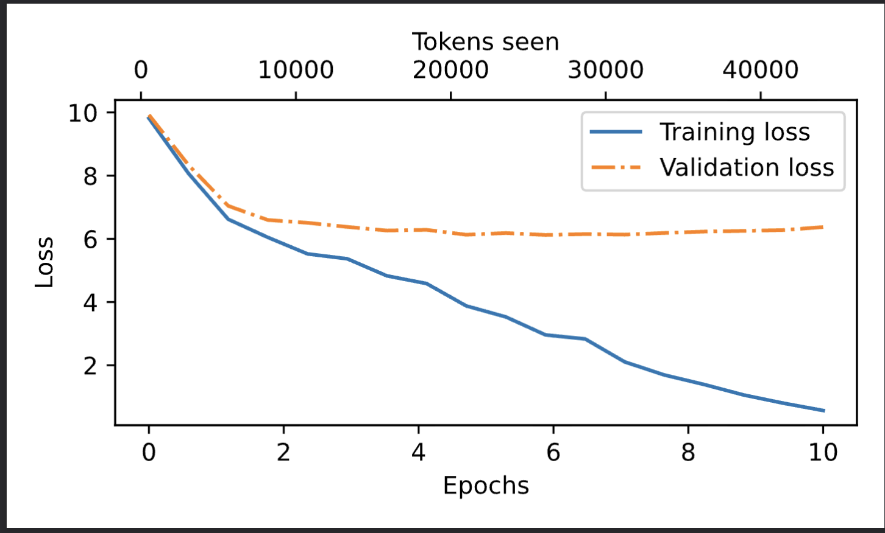
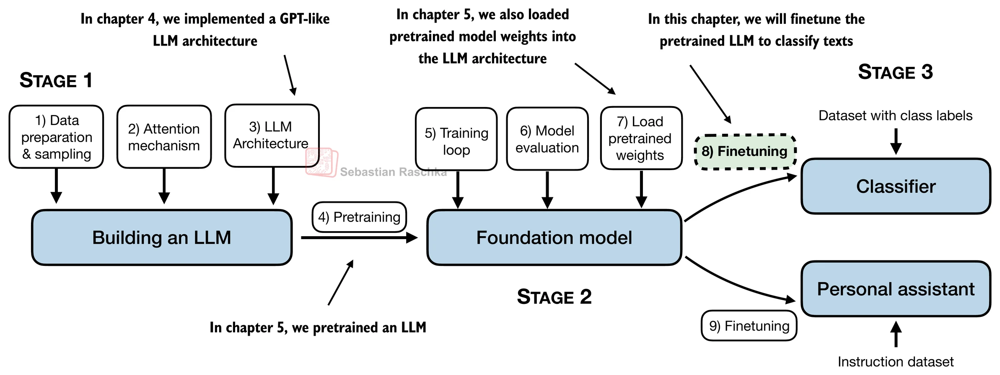

# GPT-2 from scratch

From-scratch implementation of the GPT-2 (124M and 355M) language model in PyTorch, covering BPE tokenization, the complete transformer architecture, training, and fine-tuning for classification and instruction-following tasks.

---

## Overview

This repository implements all components of the GPT-2 architecture from first principles:

- Byte Pair Encoding (BPE) tokenization via `tiktoken`
- Token and positional embeddings
- Multi-head causal self-attention with scaled dot-product scores
- Transformer blocks with pre-norm residual connections
- Next-token prediction training loop with loss tracking
- Pre-trained weight loading from OpenAI's official GPT-2 checkpoints
- Fine-tuning pipelines for binary text classification and instruction following

The implementation is presented in Jupyter notebooks with supporting Python modules for reuse across notebooks.

---

## Features

- **Full GPT-2 architecture** — `MultiHeadAttention`, `FeedForward`, `TransformerBlock`, `LayerNorm`, `GELU`, and `GPTModel` classes implemented in PyTorch
- **Two model configurations** — GPT-2 Small (124M parameters, 12 layers) and GPT-2 Medium (355M parameters, 24 layers)
- **Pre-trained weight loading** — downloads and maps OpenAI's official GPT-2 TensorFlow checkpoints into the custom PyTorch model
- **Text generation** — greedy decoding, temperature scaling, and top-k sampling
- **Classification fine-tuning** — binary spam/ham classifier on the SMS Spam Collection dataset (~89% test accuracy)
- **Instruction fine-tuning** — Alpaca-format instruction-response training with automated LLM-based evaluation (Llama-3 via Ollama)
- **Educational notebooks** — step-by-step explorations of tokenization, embeddings, attention scaling, and PyTorch fundamentals

---

## Tech stack

| Component               | Library                                                 | Version                  |
| ----------------------- | ------------------------------------------------------- | ------------------------ |
| Deep learning framework | PyTorch                                                 | >= 2.0                   |
| Tokenization            | tiktoken                                                | >= 0.5                   |
| Data handling           | pandas, NumPy, Hugging Face `datasets`                  | >= 2.0, >= 1.24, >= 2.14 |
| Visualization           | matplotlib                                              | >= 3.7                   |
| Weight download         | requests, tqdm                                          | >= 2.28, >= 4.65         |
| System monitoring       | psutil                                                  | >= 5.9                   |
| Checkpoint parsing      | TensorFlow (optional, for loading OpenAI `.ckpt` files) | —                        |

---

## Project structure

```
GPT-2/
├── EntireGPT_architecture.ipynb          # Model components: embeddings, LayerNorm, GELU, transformer blocks, GPTModel
├── gpt-2_all _entire_pipeline.ipynb      # End-to-end pipeline: data loading, tokenization, training, generation
├── multiheadAttention.ipynb              # Multi-head causal self-attention with register_buffer and causal masking
│
├── Fine_tuning/
│   ├── GPTMODEL.py                       # Reusable module: all model classes and GPT_CONFIG_124M / GPT_CONFIG_355M
│   ├── gpt_download3.py                  # Downloads OpenAI pre-trained GPT-2 weights (124M–1558M)
│   ├── classification fineTuning.ipynb   # Spam classification: dataset prep, training, evaluation, confusion matrix
│   ├── instruction_finetunig.ipynb       # Instruction following: weight loading, fine-tuning, LLM-based evaluation
│   └── instruction-data.json             # Alpaca-format dataset (instruction, input, output)
│
├── practice/
│   ├── BYTEPAIRtokenizer.ipynb           # tiktoken BPE encoding/decoding, special tokens
│   ├── TOKENEMBEDINGS.ipynb              # nn.Embedding layer: token IDs to dense vectors
│   ├── 1.ipynb                           # Custom tokenizer from scratch (regex splitting, vocabulary building)
│   ├── 2.ipynb                           # Why attention scores are scaled by sqrt(d_k)
│   └── practice.ipynb                    # PyTorch fundamentals: nn.Module, tensor reshaping, keepdim
│
├── images/                               # Architecture diagrams (13 PNGs)
├── requirements.txt                      # Python dependencies
└── .gitignore
```

### Key modules

**`Fine_tuning/GPTMODEL.py`** — Contains all model classes and configuration dictionaries. Imported by fine-tuning notebooks.

| Class                | Purpose                                                                                        |
| -------------------- | ---------------------------------------------------------------------------------------------- |
| `MultiHeadAttention` | Multi-head self-attention with causal mask via `register_buffer`                               |
| `LayerNorm`          | Layer normalization with learnable scale and shift                                             |
| `GELU`               | Gaussian Error Linear Unit (approximate form)                                                  |
| `FeedForward`        | Two-layer FFN with 4x expansion and GELU activation                                            |
| `TransformerBlock`   | Pre-norm attention + FFN with residual connections and dropout                                 |
| `GPTModel`           | Full model: token/position embeddings → N transformer blocks → layer norm → linear output head |

**`Fine_tuning/gpt_download3.py`** — Downloads OpenAI's pre-trained GPT-2 weights from `openaipublic.blob.core.windows.net` and parses TensorFlow checkpoints into a Python dictionary compatible with the custom model. Supports model sizes: 124M, 355M, 774M, 1558M.

---

## Architecture

The model follows the GPT-2 pre-norm transformer architecture:

```
Input Token IDs
      │
      ▼
┌─────────────────────────┐
│ Token Embedding (50257   │
│   × 768)                 │
│ + Position Embedding     │
│   (1024 × 768)           │
│ + Dropout                │
└────────┬────────────────┘
         ▼
┌─────────────────────────┐
│ Transformer Block × 12   │
│  ├─ LayerNorm            │
│  ├─ Multi-Head Attention │
│  │   (12 heads, d=64)    │
│  ├─ Residual + Dropout   │
│  ├─ LayerNorm            │
│  ├─ FeedForward          │
│  │   (768 → 3072 → 768)  │
│  └─ Residual + Dropout   │
└────────┬────────────────┘
         ▼
┌─────────────────────────┐
│ Layer Norm → Linear      │
│ (768 → 50257 logits)     │
└─────────────────────────┘
```

### Model configurations

| Parameter           | GPT-2 Small (124M) | GPT-2 Medium (355M) |
| ------------------- | ------------------ | ------------------- |
| Vocabulary size     | 50,257             | 50,257              |
| Context length      | 1,024              | 1,024               |
| Embedding dimension | 768                | 1,024               |
| Attention heads     | 12                 | 16                  |
| Transformer layers  | 12                 | 24                  |
| Dropout rate        | 0.1                | 0.1                 |
| QKV bias            | False              | False               |

### Diagrams

The `images/` directory contains diagrams for each architectural component:

| Diagram                    | File                                |
| -------------------------- | ----------------------------------- |
| Full GPT-2 architecture    | `images/gpt2-architecture.png`      |
| Multi-head attention       | `images/multi-head-attention.png`   |
| Self-attention computation | `images/self-attention-process.png` |
| Causal mask                | `images/causal-mask.png`            |
| Transformer block          | `images/transformer-block.png`      |
| Feed-forward network       | `images/feed-forward.png`           |
| Token embeddings           | `images/token-embeddings.png`       |
| BPE tokenization           | `images/bpe-tokenization.png`       |
| Layer normalization        | `images/layer-normalization.png`    |
| GELU activation            | `images/gelu-activation.png`        |
| Training loss curve        | `images/training-loss.png`          |
| Fine-tuning process        | `images/fine-tuning-process.png`    |
| Instruction tuning         | `images/instruction-tuning.png`     |

---

## Prerequisites

- Python 3.8+
- CUDA-capable GPU recommended for training (CPU is sufficient for inference and small-batch fine-tuning)
- 8 GB RAM minimum; 16 GB recommended for fine-tuning
- Jupyter Notebook or JupyterLab

---

## Installation

```bash
# Clone the repository
git clone https://github.com/naggynab/GPT-2.git
cd GPT-2

# Create and activate a virtual environment
python -m venv venv
source venv/bin/activate        # macOS / Linux
# venv\Scripts\activate         # Windows

# Install dependencies
pip install -r requirements.txt
```

Verify the installation:

```bash
python -c "import torch; import tiktoken; print('Ready')"
```

Expected output: `Ready`

> **Note:** The fine-tuning notebooks that load OpenAI checkpoints require TensorFlow for `.ckpt` parsing. Install separately if needed:
>
> ```bash
> pip install tensorflow
> ```

---

## Usage

### Notebook execution order

Start the notebook server with `jupyter notebook`, then follow this sequence:

| Step | Notebook                                      | Topic                             |
| ---- | --------------------------------------------- | --------------------------------- |
| 1    | `practice/BYTEPAIRtokenizer.ipynb`            | BPE tokenization with tiktoken    |
| 2    | `practice/TOKENEMBEDINGS.ipynb`               | Token embedding layers            |
| 3    | `practice/2.ipynb`                            | Attention score scaling by √d     |
| 4    | `multiheadAttention.ipynb`                    | Multi-head causal self-attention  |
| 5    | `EntireGPT_architecture.ipynb`                | Full GPTModel assembly            |
| 6    | `gpt-2_all _entire_pipeline.ipynb`            | Training loop and text generation |
| 7    | `Fine_tuning/classification fineTuning.ipynb` | Spam classification fine-tuning   |
| 8    | `Fine_tuning/instruction_finetunig.ipynb`     | Instruction-following fine-tuning |

### Training from scratch

The pipeline notebook (`gpt-2_all _entire_pipeline.ipynb`) trains GPT-2 on a text corpus with next-token prediction. Core training pattern:

```python
import torch
from Fine_tuning.GPTMODEL import GPTModel, GPT_CONFIG_124M

model = GPTModel(GPT_CONFIG_124M)
optimizer = torch.optim.AdamW(model.parameters(), lr=4e-4, weight_decay=0.1)

for epoch in range(num_epochs):
    for input_batch, target_batch in train_loader:
        optimizer.zero_grad()
        logits = model(input_batch)
        loss = torch.nn.functional.cross_entropy(
            logits.flatten(0, 1), target_batch.flatten()
        )
        loss.backward()
        optimizer.step()
```

### Text generation

```python
import tiktoken

tokenizer = tiktoken.get_encoding("gpt2")
input_ids = torch.tensor([tokenizer.encode("Once upon a time")]).to(device)

model.eval()
with torch.no_grad():
    for _ in range(50):
        logits = model(input_ids)
        next_token = logits[:, -1, :].argmax(dim=-1, keepdim=True)
        input_ids = torch.cat([input_ids, next_token], dim=1)

print(tokenizer.decode(input_ids[0].tolist()))
```

### Fine-tuning for classification

The classification notebook loads pre-trained GPT-2 weights, freezes the first 10 transformer blocks, and replaces the output head with a binary classifier:

```python
for param in model.trf_blocks[:10].parameters():
    param.requires_grad = False

model.out_head = torch.nn.Linear(cfg["emb_dim"], 2, bias=False)
```

Dataset: SMS Spam Collection (UCI). The notebook handles downloading, balancing, tokenizing, training, and evaluation.

### Fine-tuning for instruction following

The instruction notebook loads GPT-2 Medium (355M) with pre-trained weights and fine-tunes on Alpaca-format instruction-response pairs from `instruction-data.json`:

```json
{
  "instruction": "Translate English to French",
  "input": "Hello, how are you?",
  "output": "Bonjour, comment allez-vous?"
}
```

Evaluation uses an automated LLM judge (Llama-3 via Ollama).

---

## Results

| Task                  | Dataset                            | Model      | Metric          | Result  |
| --------------------- | ---------------------------------- | ---------- | --------------- | ------- |
| Spam classification   | SMS Spam Collection (UCI)          | GPT-2 124M | Test accuracy   | ~89%    |
| Instruction following | Alpaca-style JSON (1,100 examples) | GPT-2 355M | LLM judge score | ~43/100 |

<p align="center">
  
</p>

<p align="center">
  
</p>

The training loss plot confirms architecture and training loop correctness on a small dataset. Full-scale pre-training was not performed due to hardware constraints.

The instruction-following score of ~43/100 is expected for a 355M-parameter model trained for a single epoch on 1,100 examples.

---

## Implementation notes

### `register_buffer` for the causal mask

The upper-triangular causal mask is a fixed tensor, not a learned parameter. `register_buffer` ensures it:

- Moves to the correct device (CPU/GPU) with the model
- Is included in `state_dict()` for serialization
- Is excluded from optimizer updates

### `.contiguous()` before `.view()`

After `.transpose()`, tensor memory layout may be non-contiguous. `.view()` requires contiguous memory, so `.contiguous()` is called before reshaping multi-head attention outputs.

### GELU activation

GPT-2 uses the approximate form of the Gaussian Error Linear Unit instead of ReLU. GELU smoothly gates values near zero, which improves training stability in transformer models.

---

## References

**Papers:**

- [Attention Is All You Need](https://arxiv.org/abs/1706.03762) — Vaswani et al., 2017. Original transformer architecture.
- [Language Models are Unsupervised Multitask Learners](https://cdn.openai.com/better-language-models/language_models_are_unsupervised_multitask_learners.pdf) — Radford et al., 2019. GPT-2 paper.

**Learning resources:**

- [The Illustrated Transformer](https://jalammar.github.io/illustrated-transformer/) — Jay Alammar
- [The Illustrated GPT-2](https://jalammar.github.io/illustrated-gpt2/) — Jay Alammar
- [Let's Build GPT from Scratch](https://www.youtube.com/watch?v=kCc8FmEb1nY) — Andrej Karpathy

---

## Contributing

1. Fork the repository.
2. Create a feature branch: `git checkout -b my-feature`
3. Make changes and include notebook cells or tests that demonstrate them.
4. Open a pull request with a description of the change and its motivation.

---

## License

This project is for educational purposes. The model architecture follows the GPT-2 paper by OpenAI. No explicit license file is included.
